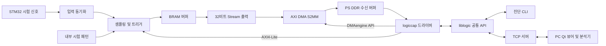

# Lucky Kernel 시스템 설계 및 인터페이스 명세 v0.1

작성일: 2026-11-03

상태: 팀 검토용 설계 제안. 개인저장 계획서와 현재 Sprint 구성을 구체화한 문서이며, 아래 수치와 API는 아직 구현·실측으로 확정된 사항이 아니다. 보드 핀, 도구 버전, DMA 드라이버 지원 조건은 12절의 선행 확인을 거친다.

## 1. 첫 버전의 동작 범위

KR260에서 외부 8채널 신호를 정해진 길이만큼 BRAM에 저장한 뒤, AXI DMA로 Linux 메모리에 옮긴다. Linux 진단 콘솔에서 먼저 데이터 일치를 검증하고, 같은 제어 API를 사용하는 TCP 서버를 통해 PC Qt 뷰어에 전달한다.

| 항목 | v0.1 제안 |
|---|---|
| 수집 방식 | 단발 수집. 수집 완료 후 전송하며, 전송·결과 보관 중 다음 수집은 시작하지 않음 |
| 입력 | 8채널, 채널 번호 CH0~CH7 |
| 목표 기준 클록 | 100 MHz. 실제 생성 클록과 구현 타이밍 통과 여부를 함께 확인 |
| 샘플 간격 | 정수 분주 D, 1~1,000,000. 클록을 새로 만들지 않고 clock enable 사용 |
| 샘플률 | 실제 기준 클록 Hz / D. 분주값과 실제 기준 클록을 결과에 함께 기록 |
| 수집 길이 N | 4 이상, MAX_SAMPLES 이하, 4의 배수 |
| BRAM 용량 | 초기 제안 MAX_SAMPLES=65,536. 합성 결과를 보고 조정하며 capability로 노출 |
| 트리거 | 즉시 시작 또는 선택한 1개 채널의 상승/하강 엣지 |
| 저장 시작 | 트리거가 성립한 샘플을 sample[0]으로 저장 |
| 저장 형식 | 1 sample = 1 byte. bit k = CHk |
| 패턴 입력 | 외부 입력 또는 내부 8비트 카운터 패턴 |
| 분석 | PC에서 UART → I2C → SPI 순서로 구현 |

첫 버전의 필수 범위는 위 동작이다. 연속 스트리밍, 프리트리거, 압축, 다중 접속, n8n 연동은 이후 작업으로 관리한다.

N=65,536일 때 수집 시간 구간의 길이는 N/Fs이므로 100 MHz에서 655.36 μs, 10 MHz에서 6.5536 ms, 1 MHz에서 65.536 ms이다. 첫 샘플과 마지막 샘플의 타임스탬프 차이는 (N-1)/Fs이다. 100 MHz 샘플링 목표와 외부에서 정확히 분석할 수 있는 통신 주파수는 별도 항목으로 검증한다.

## 2. 시스템 구조와 담당 경계



| 경계 | 제공하는 쪽 | 사용하는 쪽 | 합의할 산출물 |
|---|---|---|---|
| 수집 IP ↔ Vivado 시스템 | 석민정 | 신유지 | AXI-Lite/Stream 포트, 클록·리셋, 인터럽트 |
| 수집 IP ↔ IP 제어 코드 | 석민정 | 드라이버 전체 | 레지스터 맵, 상태 전이, 트리거·길이 정의 |
| AXI DMA ↔ 수신 코드 | 신유지 | 드라이버 전체 | DMA 구성, DT, DMAengine 채널 및 버퍼 수명 |
| 커널 ↔ 보드 프로그램 | 석민정·신유지 공동 | 이양배 | 단일 /dev/logiccap0, 공통 UAPI 헤더 |
| 공통 API ↔ CLI/TCP 서버 | 이양배 | CLI/TCP 서버 | 설정·시작·상태·조회·취소·해제 |
| 보드 ↔ Qt | 이양배 | Qt 프로그램 | TCP 프레임, 메타데이터, 원시 샘플 |
| STM32 ↔ 분석 검증 | 이양배 | 팀 전체 | 채널 연결표, 송신 패턴, 기대 해석 결과 |

드라이버는 `logiccap.ko` 하나로 통합하는 안을 권장한다. 석민정은 레지스터·수집 IP 제어 부분, 신유지는 DMAengine·수신 버퍼·완료 처리 부분을 구현한다. 수집 상태·락·장치 노드는 공유하며 DMA 레지스터와 채널은 기존 DMA provider 드라이버가 소유한다. 두 사람이 별도 모듈에서 같은 MMIO나 DMA 채널을 동시에 제어하지 않는다.

## 3. FPGA 내부 설계

### 3.1 모듈별 책임

| 모듈 | 입력 | 출력 및 책임 |
|---|---|---|
| input_sync | async din[7:0], clk, resetn | 각 입력의 2단 동기화 출력. 분주와 무관하게 매 기준 클록에서 동작 |
| sample_tick | clk, sample_div, arm | D클록마다 1클록 폭의 sample_ce |
| trigger_unit | 동기화 샘플, sample_ce, 모드·채널 | sampled edge 검출, trigger_hit |
| pattern_gen | 저장 이벤트, 패턴 모드 | counter8 시험 패턴 |
| capture_core | 샘플, sample_ce, trigger_hit, N | BRAM 쓰기, count, 상태 및 완료 |
| stream_tx | 고정된 BRAM 데이터, SEND | 4개 샘플을 32비트에 패킹하여 AXI4-Stream 출력 |
| axi_regs | AXI4-Lite | 설정·명령·상태·진단 조회 |

외부 입력은 비동기 입력으로 취급한다. 2단 동기화는 메타안정성 전파 확률을 낮추지만 채널 간 동시 전이의 완전한 일치나 매우 짧은 펄스 검출을 보장하지 않는다. 지원 가능한 통신 속도와 채널 간 관측 오차는 실제 배선·시험으로 정한다.

### 3.2 클록과 리셋

- 초기 구성은 수집 IP, AXI-Lite slave, Stream 송신부, DMA의 관련 AXI 클록을 같은 100 MHz 목표 클록에 연결한다. DMA IP의 지원 클록 구성을 생성 설정에서 확인한다.
- sample_div는 clock enable을 생성한다. RTL에서 분주 출력을 새 클록으로 사용하지 않는다.
- 다른 클록이 필요한 구간에는 검증된 AXI Clock Converter/비동기 FIFO를 배치하고 CDC를 별도로 검증한다.
- 리셋 해제는 해당 클록 도메인에 동기화한다. 리셋 후 state=IDLE, TVALID=0, pending IRQ=0이다.
- AXI-Lite 소프트 리셋으로 DMA 동작까지 끝났다고 가정하지 않는다. DMA 취소·재시작 절차는 7절을 따른다.

### 3.3 트리거와 수집 시점

1. ARM을 수락하면 설정을 고정하고 분주 카운터를 초기화한다. 첫 sample_ce는 D번째 기준 클록에 발생한다.
2. 즉시 모드에서는 첫 sample_ce의 입력이 sample[0]이다.
3. 엣지 모드에서는 ARM 후 첫 sample_ce는 이전 값 초기화에만 사용한다. 두 번째 sample_ce부터 직전 sampled 값과 비교한다.
4. 상승은 prev[ch]=0, current[ch]=1, 하강은 prev[ch]=1, current[ch]=0으로 정의한다. 연속 sample_ce 사이에서 생겼다 사라진 펄스는 검출하지 않는다.
5. 엣지가 검출된 current 값을 sample[0]으로 저장한다. 이후 매 sample_ce마다 저장하고 정확히 N개에서 멈춘다.
6. 첫 버전은 프리트리거가 없으므로 trigger_index=0이다. 트리거 대기 중 BRAM에는 저장하지 않는다.
7. 수집 완료 후 BRAM은 유지된다. DMA 준비가 늦어져도 데이터를 덮어쓰지 않는다.
8. 내부 counter8 패턴은 즉시 모드에서만 허용한다. 저장 sample[i]=i mod 256이며 ARM마다 0부터 시작한다.

### 3.4 FPGA 상태

| 값 | 이름 | 다음 상태와 조건 |
|---|---|---|
| 0 | IDLE | ARM → ARMED |
| 1 | ARMED | 트리거 성립 → CAPTURING, ABORT → ABORTED |
| 2 | CAPTURING | N개 저장 → CAPTURED, ABORT → ABORTED |
| 3 | CAPTURED | SEND → STREAMING, ABORT → ABORTED |
| 4 | STREAMING | 마지막 beat handshake → STREAM_DONE |
| 5 | STREAM_DONE | CLEAR → IDLE |
| 6 | ABORTED | CLEAR → IDLE |
| 7 | ERROR | 원인 해소·복구 후 CLEAR → IDLE |

N≥4이므로 trigger sample을 저장한 클록에 CAPTURING으로 진입하고 sample_count=1이 된다. IDLE에서만 설정 변경과 ARM을 허용한다. STREAMING 중 ABORT/CLEAR는 수락하지 않는다. 이 상태의 취소는 드라이버에서 DMA와 송신부를 함께 정리한다.

## 4. AXI4-Lite 레지스터 계약

아래는 수집 IP 기준 상대 offset이다. 실제 base address는 Vivado Address Editor와 Device Tree가 정하며 소스에 임의 절대주소를 고정하지 않는다. 데이터 폭은 32비트, 정렬은 4바이트다.

| Offset | 이름 | 접근 | 정의 / 리셋값 |
|---|---|---|---|
| 0x00 | IP_ID | RO | 0x4C4B4C41. 정수 식별값 |
| 0x04 | ABI_VERSION | RO | major: bits31:16, minor: bits15:0. 초기 0x00010000 |
| 0x08 | CAPABILITIES | RO | bit0 counter8, bit1 buffer peek, bit2 capture IRQ. 초기 0x7 |
| 0x0C | SAMPLE_CLK_HZ | RO | 실제 구성된 기준 클록 Hz |
| 0x10 | MAX_SAMPLES | RO | 실제 합성된 버퍼 샘플 용량 |
| 0x14 | SAMPLE_DIV | RW | 1~1,000,000. 기본 100 |
| 0x18 | SAMPLE_COUNT_REQ | RW | N. 기본 4096 |
| 0x1C | TRIGGER_CFG | RW | bits1:0 mode(0 immediate,1 rising,2 falling), bits10:8 channel(0~7). 기본 0 |
| 0x20 | INPUT_SOURCE | RW | 0 external, 1 counter8. 기본 0 |
| 0x24 | COMMAND | WO | bit0 ARM, bit1 ABORT, bit2 SEND, bit3 CLEAR. 한 번에 하나만 사용 |
| 0x28 | STATE | RO | 3.4절의 FPGA 상태 |
| 0x2C | SAMPLES_CAPTURED | RO | ARM 시 0, BRAM 쓰기에 성공할 때마다 1 증가 |
| 0x30 | STREAM_BYTES_SENT | RO | SEND 시 0, beat handshake마다 4 증가 |
| 0x34 | IRQ_STATUS | W1C | bit0 CAPTURE_DONE, bit1 STREAM_DONE, bit2 ERROR. 기본 0 |
| 0x38 | IRQ_ENABLE | RW | IRQ_STATUS와 같은 비트 배치. 기본 0 |
| 0x3C | ERROR_FLAGS | W1C | bit0 BAD_CONFIG, bit1 BAD_COMMAND, bit2 INTERNAL. 기본 0 |
| 0x40 | BUF_RD_INDEX | RW | 진단용 sample index. 기본 0 |
| 0x44 | BUF_RD_DATA | RO | 선택 sample의 8비트 값. 상위 24비트 0 |
| 0x48 | TRIGGER_SEEN | RO | ARM 시 0, 트리거 성립 시 1 |

규칙:

- RW 설정은 IDLE에서만 변경 가능하다. WSTRB에 따라 바이트를 병합한 후보값을 검증하고, 유효한 경우에만 갱신한다. 미사용 비트는 0으로 유지한다.
- COMMAND는 write-one pulse이다. 읽으면 0이며 WSTRB로 허용된 바이트의 명령 비트만 유효하다. 0 쓰기는 아무 동작도 하지 않는다.
- 잘못된 설정·명령은 원래 값을 유지하고 해당 ERROR_FLAGS와 ERROR IRQ를 세운다. 일반적인 잘못된 명령 때문에 진행 중인 정상 수집을 강제로 중단하지 않는다.
- 복구 불가능한 내부 오류만 state=ERROR로 전환한다. 읽기와 진단은 가능하되 정상 결과로 제공하지 않는다.
- IRQ 출력은 OR(IRQ_STATUS & IRQ_ENABLE)인 level 신호다. 이벤트는 enable 여부와 무관하게 STATUS에 기록한다. IRQ 핸들러는 원인을 읽고 W1C로 확인한다.
- 유효한 CLEAR는 진행 중인 전송이 없는 terminal 상태 또는 IDLE에서 수집 결과·오류·pending IRQ를 지우고 IDLE로 돌아간다. 설정과 IRQ_ENABLE은 유지한다.
- BUF_RD_INDEX/DATA는 CAPTURED 또는 STREAM_DONE에서만 사용한다. INDEX 쓰기 이후 DATA 읽기는 해당 BRAM 읽기 완료까지 AXI 응답을 기다린다. 파이프라인 이전 값을 반환하지 않는다.
- 버퍼 조회 시 index < SAMPLES_CAPTURED여야 한다. Stream 송신부와 진단 조회는 같은 읽기 포트를 동시에 소유하지 않는다.
- RO 레지스터 쓰기, 미정의 offset, 비정렬 접근은 AXI SLVERR로 응답한다. 외부 사용자에게 raw MMIO를 열지 않고 진단 레지스터를 allowlist로 노출한다.
- AXI AW/W 채널의 독립 도착과 R/B 채널 backpressure를 지원한다. 두 채널이 같은 사이클에 들어온다고 가정하지 않는다.
- IRQ_STATUS/ERROR_FLAGS의 W1C는 WSTRB를 적용하며, clear와 새 이벤트가 겹치면 새 이벤트를 보존한다.

## 5. BRAM → AXI4-Stream → DMA 데이터 계약

| 신호/항목 | 제안 계약 |
|---|---|
| TDATA | 32비트. [7:0]=sample[4j], [15:8]=sample[4j+1], [23:16]=sample[4j+2], [31:24]=sample[4j+3] |
| TKEEP | 4비트, 항상 0xF. N이 4의 배수이므로 부분 beat 없음 |
| TLAST | 마지막 32비트 word에서만 1. 수락될 때까지 유지 |
| TVALID | 데이터가 준비되면 세움. TREADY를 기다렸다 세우지 않음 |
| TREADY=0 | TVALID=1인 경우 TDATA/TKEEP/TLAST를 유지하고 송신 진행을 멈춤 |
| 진행 기준 | TVALID && TREADY인 클록에서만 전송 카운터와 word index 진행 |
| 전체 패킷 | 1 capture = 1 AXI4-Stream packet = N bytes = N/4 beats |
| DMA 방향 | S2MM, DMA_DEV_TO_MEM. MM2S는 필수 범위에서 사용하지 않음 |

BRAM 읽기 지연을 흡수할 word staging register를 둔다. 구현 초기는 4바이트를 순차로 읽어 1 word를 구성해도 된다. 실제 송신률은 따로 측정한다. 저장 중 실시간 DMA 스트리밍을 하지 않으므로 송신 backpressure가 샘플 간격을 바꾸지 않는다.

예: sample bytes `00 01 02 03 04 05 06 07`은 AXIS word `0x03020100`, `0x07060504`가 되고, DDR와 PC의 sample bytes도 `00 01 02 03 04 05 06 07`이어야 한다. DMA 메모리 바이트 배치는 첫 보드 시험에서 확인한다.

DMA 준비 길이는 N bytes로 지정한다. AXI DMA의 수신 버퍼는 도착 패킷보다 작아서는 안 된다. TLAST가 누락되면 정상 완료로 취급하지 않는다. 근거: [AMD PG021 S2MM_LENGTH](https://docs.amd.com/r/en-US/pg021_axi_dma/S2MM_LENGTH-S2MM-DMA-Buffer-Length-Register-Offset-58h).

TVALID 및 stall 시 신호 유지 규칙의 근거: [AMD AXI4-Stream handshake](https://docs.amd.com/r/en-US/ug1483-model-composer-sys-gen-user-guide/AXI4-Stream-Support-in-Model-Composer).

DMA IP의 Simple/SG 모드는 사용 커널의 Xilinx DMA provider 지원과 함께 확정한다. 애플리케이션의 단발 수집은 DMA IP를 반드시 Simple 모드로 설정해야 한다는 뜻이 아니다. Linux DMAengine에서 1회 전송을 완료할 수 있는 조합을 우선 채택한다.

## 6. Linux 드라이버와 사용자 API

### 6.1 소유권

- `/dev/logiccap0`은 한 프로세스만 open할 수 있고 두 번째 open은 EBUSY이다.
- CLI 직접 실행 모드와 TCP 서버는 장치 소유권을 공유하지 않는다. 서버가 실행 중일 때 CLI는 같은 TCP 프로토콜을 이용하는 원격 모드로 진단한다.
- 커널 드라이버가 IP 상태, DMA 채널, DMA 버퍼, capture_id를 소유한다. CLI와 TCP 서버에서 DMA MMIO를 직접 조작하지 않는다.
- 드라이버의 process-context mutex로 CONFIG/START/CANCEL/RELEASE를 직렬화한다. IRQ/callback은 최소 상태 기록과 대기자 알림만 하고, 잠들 수 있는 정리는 worker에서 실행한다.
- DMA 전송 중 버퍼를 해제하거나 CPU에서 결과로 읽지 않는다. close 시 전송과 callback 정리를 완료한 뒤 소유권을 해제한다.

### 6.2 사용자 공개 연산

공통 헤더 `include/logiccap_uapi.h`를 석민정·신유지·이양배가 함께 사용한다. ABI 버전 1을 명시하고 ioctl 번호·구조체 크기는 헤더 작성 작업에서 고정한다. 모든 필드는 고정폭 정수, reserved=0이며 raw 포인터·C enum·long을 ABI에 사용하지 않는다. 다음은 연산의 의미와 필수 필드 계약이다.

| 연산 | 입력 | 반환/동작 |
|---|---|---|
| GET_CAPS | abi_version | hw_abi, feature_bits, sample_clk_hz, max_samples, max_div |
| CONFIG | abi_version, sample_div, sample_count, trigger_mode, trigger_channel, input_source, trigger_timeout_ms, dma_timeout_ms | 검증된 실제 설정. 전체 설정을 검사한 뒤 적용 |
| START | 없음 | capture_id. 커널이 설정을 고정하고 ARM; 비동기로 수집 진행 |
| GET_STATUS | 없음 | capture_id, sw_state, hw_state, samples_captured, stream_bytes_sent, error_code, 각 누적 카운터 |
| GET_RESULT | capture_id | READY일 때 고정된 설정·샘플 수·payload_bytes·trigger_index |
| read | 사용자 버퍼와 크기 | READY 결과의 원시 샘플 바이트. 부분 읽기 지원 |
| CANCEL | capture_id | 해당 작업 취소 및 자원 정리 요청 |
| RELEASE | capture_id | 결과 보관 해제, CLEAR 후 IDLE. 새 수집 허용 |
| DIAG_REG_READ | 허용 offset | IP 설정·상태 레지스터 값 |
| DIAG_REG_WRITE | 허용 설정 offset, value | IDLE에서만 허용. CONFIG와 같은 검증 적용 |
| DIAG_BUF_READ | index | 고정된 BRAM의 해당 샘플. 전송 중에는 EBUSY |

진단 쓰기는 SAMPLE_DIV/SAMPLE_COUNT_REQ/TRIGGER_CFG/INPUT_SOURCE만 허용한다. COMMAND, DMA 주소, IRQ 제어는 드라이버 내부 전용이다. 진단 쓰기도 드라이버의 cached configuration을 갱신하여 다음 START에 반영한다.

소프트웨어 상태는 `IDLE, ARMED, CAPTURING, TRANSFER_PENDING, TRANSFERRING, READY, CANCELLED, ERROR`로 고정한다. READY는 DMA 완료와 길이·하드웨어 완료 상태를 모두 검증한 후에만 설정한다. FPGA의 STREAM_DONE만으로 READY로 판정하지 않는다.

START는 IDLE에서만 허용한다. 결과는 RELEASE 전까지 유지한다. GET_RESULT와 status에는 capture_id를 포함하며, 잘못된 ID의 CANCEL/RELEASE/조회는 ESTALE이다. capture_id는 드라이버 수명 내에서 증가하는 32비트 값이며 0은 사용하지 않는다. 드라이버 재시작 시 기존 세션과 결과는 무효다.

read는 READY 이전에 EAGAIN, 오류 결과는 EIO, 취소 결과는 ECANCELED이다. READY에서는 파일별 cursor로 읽고 끝에서 0을 반환한다. `llseek`는 READY 원시 데이터 범위에서 허용하고 START/RELEASE에서 cursor를 0으로 초기화한다. `poll()`은 READY에 POLLIN, ERROR에 POLLERR, CANCELLED에 POLLERR를 알린다. 취소인지 오류인지는 GET_STATUS로 구별한다.

타임아웃 제안값은 trigger_timeout_ms=1000, dma_timeout_ms=1000이다. 각각 1~60,000 ms만 허용한다. 트리거 대기는 ARMED 진입 시부터, DMA 대기는 DMA issue 시부터 측정한다. 수집 자체 제한시간은 ceil(N×D×1000/sample_clk_hz)+100 ms이다. 큰 분주값에서 정상 수집을 트리거 타임아웃으로 중단하지 않는다.

### 6.3 공통 라이브러리

`liblogic`는 open/config/start/status/wait/result/read/cancel/release를 감싼다. CLI와 TCP 서버에 각각 상태 전이 코드를 복제하지 않는다. PC 전용 mock backend는 이 라이브러리와 같은 설정·결과 의미를 제공한다.

초기 UAPI 헤더에서 반드시 고정할 항목: ioctl magic/번호, 구조체의 byte size와 padding, ABI major 일치 검사, reserved 검증, 32/64비트 호환 정책. 이 항목을 완료하기 전 사용자 프로그램과 커널 양쪽에서 별도 구조체를 만들지 않는다.

## 7. 정상 실행과 오류 복구 순서

### 7.1 정상 수집

1. 프로그램이 GET_CAPS로 ABI·실제 클록·용량을 확인한다.
2. CONFIG로 설정 전체를 검증하고 IP 레지스터에 적용한다.
3. START가 capture_id를 발급하고 ARM한다. 즉시 반환하므로 서버는 계속 STATUS/CANCEL 요청을 받을 수 있다.
4. CAPTURE_DONE IRQ로 N개 저장을 확인한다. IRQ 원인과 sample_count를 읽어 검증하고 W1C 처리한다. 필요 시 worker에서 상태를 재확인한다.
5. DMAengine 채널에 N bytes 수신 전송을 준비·submit·issue한다. 준비에 실패하면 SEND하지 않고 ERROR로 끝낸다.
6. DMA가 수신을 시작할 수 있도록 issue한 뒤 수집 IP에 SEND한다. 실제 stream handshake는 TREADY를 따른다.
7. callback과 DMA 상태를 확인하고, STREAM_DONE 및 STREAM_BYTES_SENT=N을 제한시간 안에 확인한다. provider가 유효한 residue를 제공하면 residue=0도 검사한다. 지원하지 않는 residue를 0으로 간주하지 않는다.
8. DMA API의 동기화 규칙에 맞춰 CPU가 버퍼를 읽을 수 있게 한 후 READY로 전환한다.
9. 프로그램이 메타데이터와 N bytes를 읽고 검사·표시한다.
10. RELEASE로 결과를 해제하고 IDLE로 돌아간다.

DMA 채널 요청·전송 준비·submit·issue·종료는 [Linux DMAengine client API](https://docs.kernel.org/driver-api/dmaengine/client.html)를 따른다. 버퍼의 CPU 주소와 DMA 주소를 구별하고, DMA에 적합한 device 및 mapping API를 사용한다. 근거: [Linux DMA mapping guide](https://docs.kernel.org/core-api/dma-api-howto.html).

### 7.2 취소와 복구

| 상황 | 처리 | 결과 |
|---|---|---|
| 설정 범위 오류 | ARM 이전 거절. 유효 설정 유지 | EINVAL |
| 수집·결과 보관 중 CONFIG/START | 상태 유지 | EBUSY |
| 트리거 대기 초과 | IP ABORT, IRQ 정리 | ERROR / TRIGGER_TIMEOUT |
| 수집 시간 초과 | IP ABORT, 원인·count 저장 | ERROR / CAPTURE_TIMEOUT |
| DMA 준비 실패 | SEND하지 않음, 진단 정보 유지 | ERROR / DMA_SETUP |
| DMA 전송 실패·시간 초과 | DMA 종료·callback 동기화 후 stream 경로 복구 | ERROR / DMA_ERROR 또는 DMA_TIMEOUT |
| 잘못된 수신 길이·미완료 stream | 결과 공개 금지, 복구 필요 | ERROR / LENGTH_MISMATCH |
| ARMED/CAPTURING에서 CANCEL | IP ABORT, 부분 결과 폐기 | CANCELLED |
| TRANSFERRING에서 CANCEL | worker에서 DMA 종료·동기화, stream 경로 복구 후 완료 | CANCELLED 또는 ERROR / RECOVERY_FAILED |
| 네트워크 연결 종료 | 서버가 소유한 작업 취소·결과 해제 | 다음 접속은 이전 capture_id를 재사용하지 않음 |

전송 취소에서는 provider의 `dmaengine_terminate_sync()` 등 지원되는 종료 절차로 DMA와 callback을 먼저 멈추고, source stream 상태를 정리한다. 대기 중 TVALID를 명령 한 번으로 임의 제거하지 않는다. DMA provider 종료/리셋과 source stream reset의 조합은 실제 커널에서 fault injection으로 검증한다. 정확한 reset 연결은 해당 provider 버전·Vivado 구조 확인 후 확정한다. 복구 검증 실패 시 RECOVERY_FAILED로 잠그고 START를 거부한다. 검증된 장치 재초기화 절차를 수행한 뒤에만 재개한다.

오류 원인은 최초 원인과 복구 결과를 각각 보존한다. timeout이 난 작업을 자동 재시도하여 성공으로 덮어쓰지 않는다. 반복 시험은 새로운 capture_id로 다시 시작한다.

## 8. TCP 프로토콜 제안

### 8.1 공통 프레임

초기 서버 포트 제안은 TCP 5000, 한 번에 1개 제어 세션이다. 네트워크 연결을 처리하는 스레드와 장치 대기 worker를 분리해 수집 중에도 STATUS/CANCEL이 가능하게 한다.

| Header byte offset | 크기 | 필드 |
|---|---|---|
| 0 | 4 | magic: ASCII `LKLA` |
| 4 | 2 | protocol_version=1 |
| 6 | 2 | message_type |
| 8 | 4 | payload_length |
| 12 | 4 | request_id. 요청에서는 1 이상 |

헤더는 총 16 bytes이며 모든 정수 필드는 network byte order(big endian)이다. 제어 payload는 UTF-8 JSON이다. 샘플 payload는 원시 바이트이므로 bit/byte를 뒤집지 않는다. TCP recv 1회가 프레임 1개라는 가정을 하지 않고 `read_exact(16)` → 길이 검증 → `read_exact(payload_length)` 순서로 파싱한다.

제어 payload 최대는 16 KiB, DATA payload 최대는 MAX_SAMPLES+12 bytes이다. 길이와 타입을 검사한 뒤 메모리를 할당한다. 미지원 버전·잘못된 magic·과대 프레임은 연결을 종료하고, 유효한 프레임의 설정 오류는 ERROR 응답으로 알린다.

| 요청 type | 이름 | 동작 |
|---|---|---|
| 0x0001 | HELLO | 서버·프로토콜·하드웨어 capability 조회 |
| 0x0002 | CONFIG | 드라이버 CONFIG와 같은 의미 |
| 0x0003 | START | 비동기 시작, capture_id 응답 |
| 0x0004 | STATUS | 진행·오류·counter 조회 |
| 0x0005 | FETCH | capture_id의 READY 결과 조회 |
| 0x0006 | CANCEL | capture_id 취소. 정리 완료 후 응답 |
| 0x0007 | RELEASE | 결과 보관 해제 |

일반 응답 type은 요청 type OR 0x8000, ERROR는 0xFFFF, DATA는 0x9000이다. 모든 응답은 원 요청의 request_id를 그대로 돌려준다. HELLO 이후 CONFIG/START/STATUS/FETCH를 사용한다. 첫 버전은 unsolicited event를 보내지 않고 STATUS polling으로 진행을 확인한다.

CONFIG 예:

```json
{"sample_div":100,"sample_count":4096,"trigger_mode":"rising","trigger_channel":0,"input_source":"external","trigger_timeout_ms":1000,"dma_timeout_ms":1000}
```

FETCH 요청 payload는 `{"capture_id":42}`이다. 성공 시 서버는 같은 request_id의 FETCH 응답 메타데이터를 보낸 뒤 DATA 프레임 1개를 보낸다. 이 두 프레임 사이에 다른 응답을 끼워 넣지 않는다.

FETCH 메타데이터 예:

```json
{"capture_id":42,"sample_clk_hz":100000000,"sample_div":100,"sample_count":4096,"channel_count":8,"trigger_mode":"rising","trigger_channel":0,"input_source":"external","trigger_index":0,"sample_encoding":"u8-channel-bits","payload_bytes":4096}
```

DATA payload는 `capture_id:u32`, `sample_offset:u32`, `sample_count:u32`의 12-byte big endian prefix 다음에 샘플 바이트가 온다. 첫 버전은 분할 전송하지 않으므로 sample_offset=0, sample_count=N, 전체 payload_length=12+N이다. Qt는 capture_id와 길이를 메타데이터에 대조한다. 전송 중 단절되면 전체 결과를 실패로 처리한다.

서버는 FETCH마다 장치 read cursor를 0으로 돌려 같은 READY 결과를 재전송할 수 있다. RELEASE 전에는 새 START를 거절한다. CANCEL의 정리를 기다리는 동안에도 네트워크 처리를 멈추지 않고 worker 결과를 기다린 뒤 응답한다.

ERROR payload 예: `{"code":"BUSY","capture_id":42,"message":"capture result must be released"}`. code는 INVALID_CONFIG, BUSY, STALE_CAPTURE, NOT_READY, TRIGGER_TIMEOUT, CAPTURE_TIMEOUT, DMA_SETUP, DMA_ERROR, DMA_TIMEOUT, LENGTH_MISMATCH, RECOVERY_FAILED, INTERNAL 중 하나이다. CANCELLED 상태는 정상 STATUS 응답에 표시한다.

## 9. 진단 CLI와 로그

명령 구문 제안:

```text
logicdiag info
logicdiag regs
logicdiag capture --source counter8 --trigger immediate --div 1 --samples 4096 --out capture.bin
logicdiag capture --source external --trigger rising --channel 0 --div 100 --samples 4096 --out uart.bin
logicdiag test --pattern counter8 --div 1 --samples 4096 --repeat 100 --log result.jsonl
logicdiag --remote 192.168.1.20:5000 info
```

capture는 CONFIG → START → wait → GET_RESULT/read → 저장 → RELEASE 전체를 수행한다. 설정 레지스터 진단 쓰기도 공통 API를 통한다. 직접 모드의 단일 프로그램 내부 진단 메뉴에서 status/cancel을 제공하고, 별도 프로세스에서 실행하는 제어 명령은 서버 원격 모드를 이용한다. 두 번째 직접 실행 프로세스가 장치를 강제로 탈취하지 않는다.

시험 패턴은 counter8에서 expected[i]=i&0xFF이다. 100회 각각에 대해 N개 길이, 모든 바이트, trigger_index, 전송 카운터를 검사한다. 실패 시 최초 불일치 index·expected·actual을 출력하고 성공/실패/timeout 횟수를 각각 합산한다.

JSONL 로그는 실행 단위 run_id와 capture 단위 record를 구별한다. 각 capture record는 timestamp_utc, run_id, capture_id, SW/FPGA ABI 버전, sample_clk_hz, 전체 설정, expected/received sample 수, stream_bytes_sent, result, first_mismatch_index, expected, actual, error_code, recovery_result, elapsed_ms를 포함한다. 측정하지 않은 값은 0으로 꾸미지 않고 null로 기록한다.

IP IRQ 횟수와 DMA 완료 callback 횟수는 구별한다. DMA callback 횟수는 하드웨어 IRQ 횟수와 동일하다고 표시하지 않는다. DMA 하드웨어 IRQ 횟수가 필요하면 해당 provider 또는 /proc/interrupts의 지원 정보를 별도 수집한다.

## 10. Qt와 프로토콜 분석 계약

- Qt 내부 CaptureData는 메타데이터와 QByteArray sample bytes를 함께 보관한다. 네트워크 수신, 파형 표시, 프로토콜 분석을 분리한다.
- 시간축은 sample index × sample_div / sample_clk_hz로 계산한다. trigger-relative 시간은 (index-trigger_index)×sample_div/sample_clk_hz이다.
- CHk는 `(sample[i] >> k) & 1`이다. 채널 표시 on/off가 원시 데이터나 채널 번호를 바꾸지 않는다.
- 분석기는 socket·드라이버에 직접 접근하지 않고 CaptureData와 decoder 설정을 받는다. 저장된 시험 파일로 독립 검증한다.
- UART 설정: RX 채널, baud, data bits, parity, stop bits, idle polarity. 초기 기본 검증은 115200 baud, 8N1, idle high이다.
- I2C 설정: SDA/SCL 채널. 초기 검증은 7-bit 주소, START/STOP, ACK/NACK, write/read 바이트 순서다.
- SPI 설정: SCLK/MOSI/MISO/CS 채널, mode 0~3, bits/word, bit order, CS polarity. 초기 검증은 mode 0, 8-bit, MSB first이다.
- decoder 결과는 protocol, start_sample, end_sample_exclusive, decoded value, error_code를 갖는다. 인덱스 범위는 0≤start<end≤N이다.
- capture 경계에서 잘린 프레임은 incomplete로 구별한다. 충분한 샘플이 없는 구간을 정상 바이트로 확정하지 않는다.
- STM32 기본 송신 패턴은 UART `55 AA 00 FF 31 32 33` 반복, I2C는 고정 주소·레지스터·payload 교환, SPI는 mode별 고정 바이트 교환으로 정의한다. I2C/SPI의 상대 장치·배선·주소는 시험 fixture에서 확정한다.
- UART 115200의 첫 시험은 예를 들어 Fs=10 MHz, N=65,536으로 수행한다. 목표 신호 속도별 최소 sampling ratio는 decoder 시험으로 정하며 100 MHz 샘플링만으로 모든 외부 신호를 해석 가능하다고 주장하지 않는다.

## 11. 인터페이스 검증과 완료 기준

| ID | 시험 | 합격 기준 | 담당 |
|---|---|---|---|
| IF-01 | ID/ABI/clock/capacity 읽기 | RTL 구성과 동일, 드라이버가 미지원 ABI 거부 | 석민정·신유지 |
| IF-02 | AXI-Lite 채널 지연·WSTRB | AW/W 별도 도착, 부분 쓰기, 응답 stall에서 값 보존 | 석민정 |
| IF-03 | immediate capture | D별 정확한 N개, sample 간격 D클록 | 석민정 |
| IF-04 | rising/falling trigger | 첫 baseline sample 이후 검출, trigger sample이 index 0 | 석민정 |
| IF-05 | counter8 N=4,4096,MAX | 모든 i에서 sample[i]=i&255 | 팀 전체 |
| IF-06 | 임의 TREADY stall | 중복·누락 없음, stall 중 payload 고정, TLAST 1회 수락 | 석민정·신유지 |
| IF-07 | DMA 수신 | payload=N, stream bytes=N, 메모리 바이트 순서 일치 | 신유지 |
| IF-08 | 입력/상태 오류 | N=0, N>MAX, N%4!=0, div=0, 잘못된 채널을 거부 | 팀 전체 |
| IF-09 | 트리거 미발생·CANCEL | 정해진 상태·오류 반환, 부분 데이터 성공 공개 없음 | 팀 전체 |
| IF-10 | DMA fault·timeout·늦은 callback | 버퍼 조기 해제 없음, 복구 성공 후 새 capture 성공 또는 명확한 lockout | 신유지·석민정 |
| IF-11 | 반복 시험 100회 | IF-05 데이터 모두 일치, capture_id와 로그 추적 가능 | 이양배 |
| IF-12 | TCP 분할·병합 수신 | header/body가 1바이트 단위로 와도 파싱, 연속 프레임 구분 | 이양배 |
| IF-13 | TCP 단절·잘못된 ID/길이 | 결과 혼합 없음, 장치 소유권과 취소 정리 정상 | 이양배 |
| IF-14 | Qt mock/실측 비교 | 같은 샘플 파일의 파형·시간축·decode 결과 일치 | 이양배 |
| IF-15 | STM32 프로토콜 시험 | 송신 fixture와 해석 바이트·오류 위치 일치 | 팀 전체 |

단위 검증은 RTL 시뮬레이션 → 보드 MMIO → BRAM peek → DMA → 콘솔 반복 → TCP → Qt → 실제 통신 순서로 진행한다. 하위 계층 시험에 합격한 데이터와 기대값을 다음 계층에서도 재사용한다.

## 12. Sprint 0에서 먼저 확인하고 확정할 항목

| 항목 | 확인 결과로 남길 내용 | 주 담당 |
|---|---|---|
| KR260 입력 연결 | 사용할 Pmod, CH0~CH7의 커넥터 핀·FPGA package pin·IOSTANDARD·GND, STM32 핀 매핑 | 석민정·신유지 |
| 전기 조건 | 신호 전압, 공통 GND, I2C pull-up 및 상대 장치 조건 | 팀 전체 |
| 도구·부팅 환경 | Vivado 버전, 보드 파일, Linux 이미지·커널 버전, bitstream/DT 배포·복구 절차 | 신유지 |
| DMA provider | 사용 커널의 지원 모드, DT binding, channel 이름 rx, 주소 폭, length 폭, completion/residue 지원 | 신유지 |
| AXI 시스템 | base address, IRQ route·trigger type, clock/reset 연결, DMA DDR 경로 및 주소 도달성 | 신유지·석민정 |
| RTL 계약 | 4절 레지스터와 5절 sample packing, N/div 범위, trigger 기준 | 석민정 |
| 커널 UAPI | ioctl 값, 구조체 layout, 상태·errno, 취소와 버퍼 수명 | 석민정·신유지 |
| 앱 계약 | TCP framing, capture_id 수명, CLI 구문, 로그 및 파일 fixture | 이양배 |
| 성능 목표 | MAX_SAMPLES 합성 결과, 100 MHz 타이밍 결과, 프로토콜별 검증 속도 | 팀 전체 |

KR260의 Pmod 커넥터 위치는 J2/J18/J19/J20이며, 공식 가이드의 Pmod 전원 규격은 3.3 V이다. 전원 규격만으로 개별 I/O의 5 V 허용 여부를 추정하지 않는다. 정확한 핀·bank 전압·배선은 회로도와 사용 보드 정의를 확인한 후 XDC와 배선표에 기록한다. 근거: [AMD UG1092 Interfaces](https://docs.amd.com/r/en-US/ug1092-kr260-starter-kit/Interfaces), [AMD UG1092 Powering Peripherals](https://docs.amd.com/r/en-US/ug1092-kr260-starter-kit/Powering-the-Starter-Kit-and-Power-Budgets).

현재 보드 설계·커널 구성·실측 데이터가 없는 상태이므로 실제 XDC pin과 MMIO 절대주소, DMA reset 연결을 이 문서에서 임의로 확정하지 않는다. 나머지 계약을 먼저 합의하면 각 담당은 mock과 시뮬레이션으로 개발을 시작할 수 있다.

## 13. Jira 설계 작업의 구체적인 분리

기존 SCRUM-5의 제목을 `시스템 구조 및 인터페이스 명세 v1 확정`으로 바꾸고 아래 하위 작업을 둔다. 각 작업은 문서·표·헤더·fixture 중 검토 가능한 산출물을 가져야 한다.

| 하위 작업 | 담당 | 산출물 | 완료 조건 |
|---|---|---|---|
| SYS-01 데이터 경로·모듈 책임 정의 | 공동 | 구조도, 소유권 표 | 중복 제어 주체가 없고 수집 1회 순서를 설명 가능 |
| SYS-02 보드 입력·클록·리셋 정의 | 석민정·신유지 | 채널 배선표, XDC 초안, reset diagram | 실제 보드 핀·I/O 조건 확인 |
| SYS-03 레지스터·상태·trigger 명세 | 석민정 | register 표, FSM, cycle 예제 | immediate/rising/falling 및 잘못된 명령 결과 확정 |
| SYS-04 AXIS·DMA 수신 계약 | 신유지·석민정 | packing fixture, DMA 구성표, DT 초안 | N bytes·TLAST·버퍼 수명·복구 경계 합의 |
| SYS-05 공통 커널 UAPI 정의 | 석민정·신유지, 사용자 이양배 | logiccap_uapi.h, 호출 순서 예제 | 양쪽에서 같은 헤더 사용, layout·에러·취소 확정 |
| SYS-06 CLI·TCP·저장 형식 정의 | 이양배 | framing 명세, JSON 예제, 샘플 파일 | 같은 fixture를 mock 서버와 Qt에서 읽음 |
| SYS-07 프로토콜 시험 fixture 정의 | 이양배 | STM32 송신값·배선·기대 decode | UART 기본 시험을 FPGA 없이 준비 가능 |
| SYS-08 인터페이스 검증 계획 확정 | 공동 | IF-01~15 시험표 | 각 시험의 담당·입력·기대값·증빙 경로 존재 |

SYS-03/04/05는 Sprint 1의 병렬 개발을 시작하기 전에 서로 대조한다. 일정 때문에 미확정 값이 남으면 담당과 확정 시점을 표시하고, 영향을 받는 부분은 mock으로 진행한다. 완료 여부는 회의 개최가 아니라 산출물과 검증 예제로 판단한다.

## 14. 권장 저장 구조

```text
docs/                   설계 명세, 배선표, 시험 절차
include/                공통 UAPI 헤더
fpga/rtl/               수집·레지스터·stream RTL
fpga/tb/                레지스터·trigger·backpressure 시험
fpga/vivado/            재현 가능한 BD/Tcl/XDC
linux/driver/           단일 logiccap driver
linux/device-tree/      실제 환경별 DT/overlay
software/liblogic/      보드 공통 API
software/logicdiag/     진단 콘솔
software/logicserver/   TCP 서버
pc/qt/                  파형 뷰어·decoder
tests/fixtures/         counter8·UART·I2C·SPI 원시 파일 및 메타데이터
stm32/                  시험 신호 firmware
results/                반복 시험 로그·성능 측정 결과
```

이 문서 외의 디렉터리·소스·Jira 이슈는 아직 생성하거나 변경하지 않았다. v0.1 검토 후 공통 계약을 v1으로 고정하고 이후 변경은 FPGA ABI·커널 ABI·TCP 버전의 호환성을 함께 검토한다.
